# 冴え (Sae)

> **Know your sharpness.** Measure your brain's alertness and sleep debt in 90 seconds a day — no wearable required.

冴え (*Sae*, from 「頭が冴える」— "the mind is sharp and clear") is a native iOS app that turns a
scientifically validated reaction-time test into a daily readout of how awake your brain really is.
No ring, no wrist band — just your phone and a 90-second micro-test.

Built as a portfolio piece for Japanese product ("自社開発") companies, with internationalization (JA / EN / KO) as a first-class design constraint.

| | Name | Character | Tagline |
|--|------|-----------|---------|
| 🇯🇵 | 冴え / さえ | さえちゃん | 「冴え」の言葉遊びがそのまま成立 |
| 🇬🇧 | Sae | Saechaan | *Know your sharpness* |
| 🇰🇷 | 사에 | 사에짱 | *당신의 각성을 재다* |

---

## Why

- **Japan is #1 in the OECD for sleep deprivation**, and "睡眠負債" (sleep debt) is a national buzzword — yet people can't reliably judge their own alertness.
- The **Psychomotor Vigilance Task (PVT)** is the sleep-science gold standard used by NASA and sleep labs: reaction time degrades in a precise, measurable way as sleep debt accumulates.
- Most reaction-time apps are *games* with no scientific grounding, and most sleep apps only track *while you sleep*. Sae actively measures **waking brain alertness** — the gap those apps leave open.

## What it measures

| Signal | Method | iOS tech | Meaning |
|--------|--------|----------|---------|
| **Alertness** | PVT reaction-time test (~60–90s) | High-precision timing (`CADisplayLink`) | Core sleep-debt indicator |
| **Autonomic / stress** | HRV (SDNN, as HealthKit provides it) | HealthKit (Apple Watch) or camera PPG* | Recovery state |
| **Physical fatigue** | Physiological hand tremor, 5–12 Hz band | CoreMotion (10 s hold) | Reference only, same-device comparisons |

These fuse into a daily **冴え度 (Sae-do) score, 0–100**, plus a trend chart. *(\*Camera PPG is a stretch goal.)*

## Screenshots

From first launch to the trend: onboarding → home → instructions → test → result with Saechaan's line → 14-day trend.

| Onboarding | Home | Instructions | Test | Result | Trend |
|---|---|---|---|---|---|
| 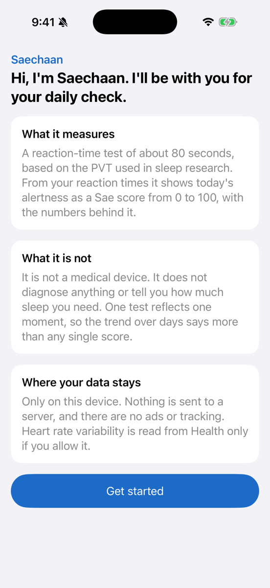 | 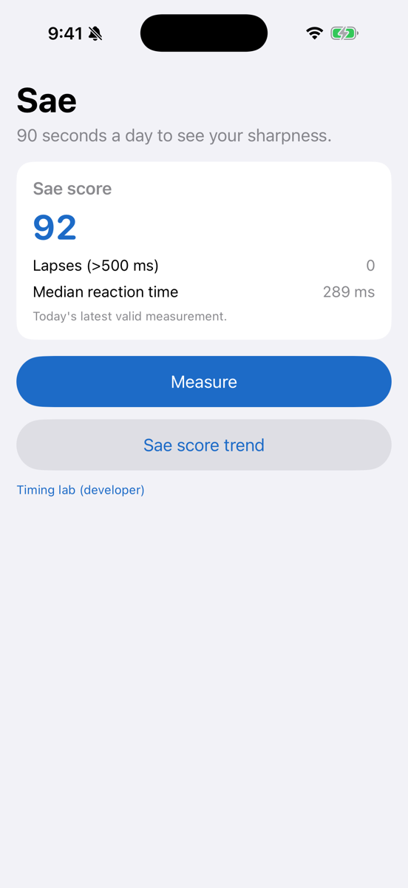 | 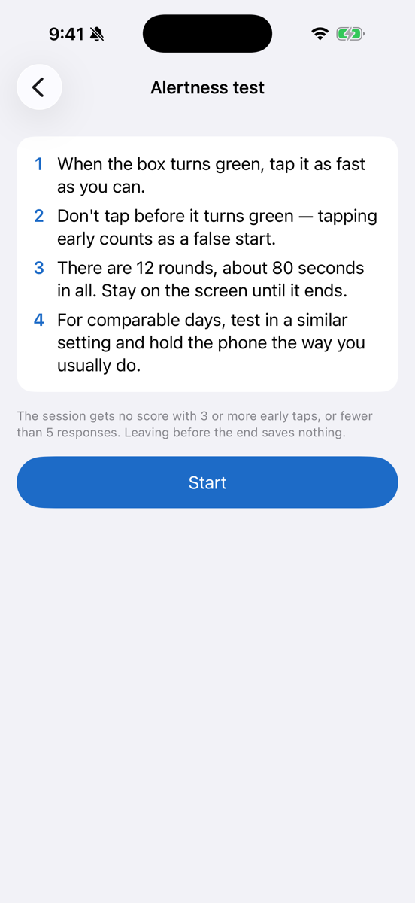 | 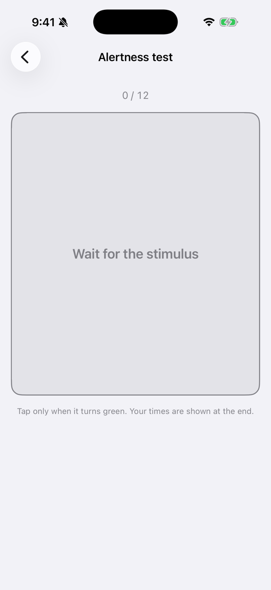 | 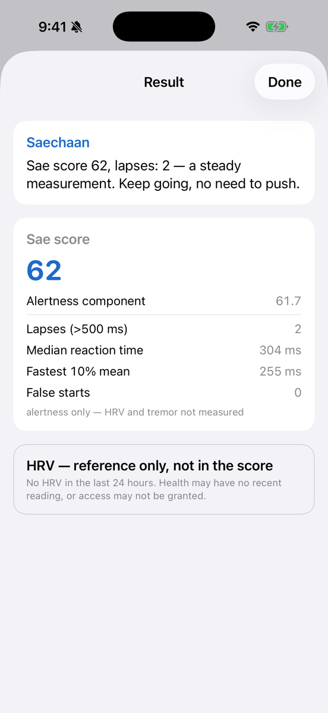 | 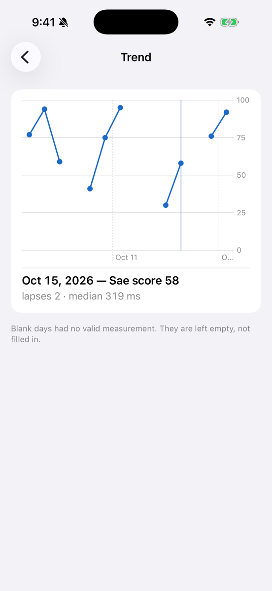 |
| 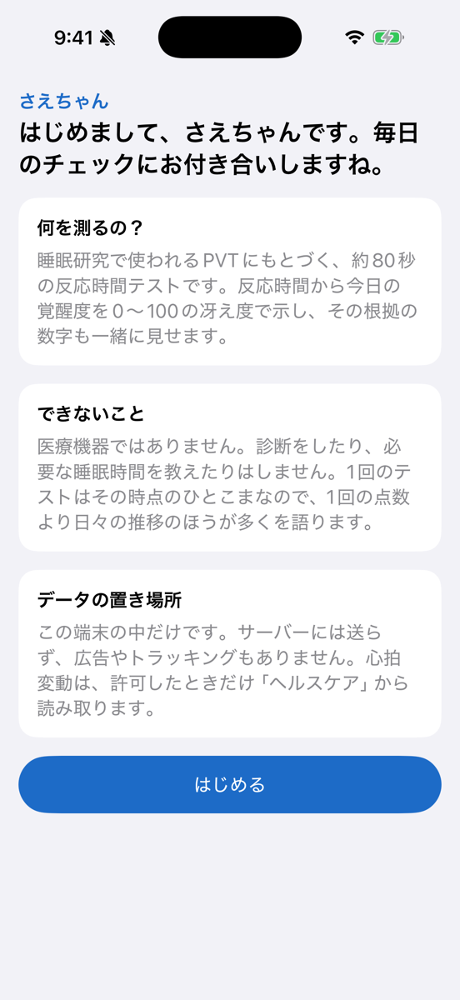 | 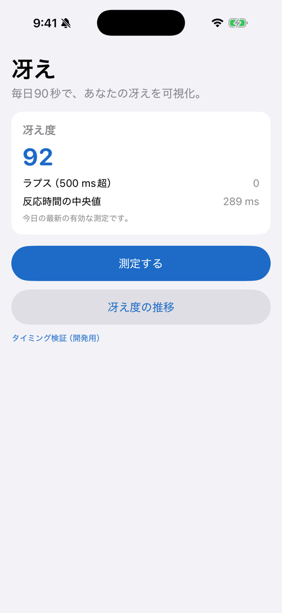 | 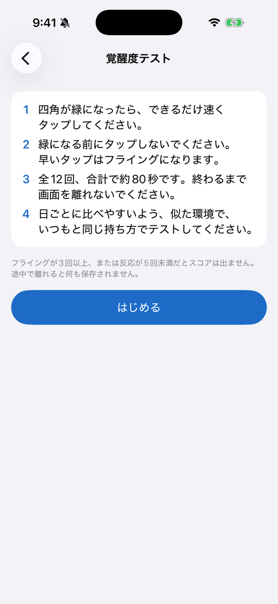 | 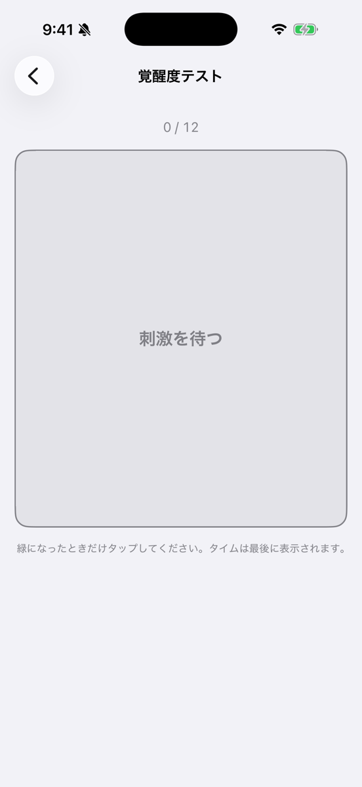 | 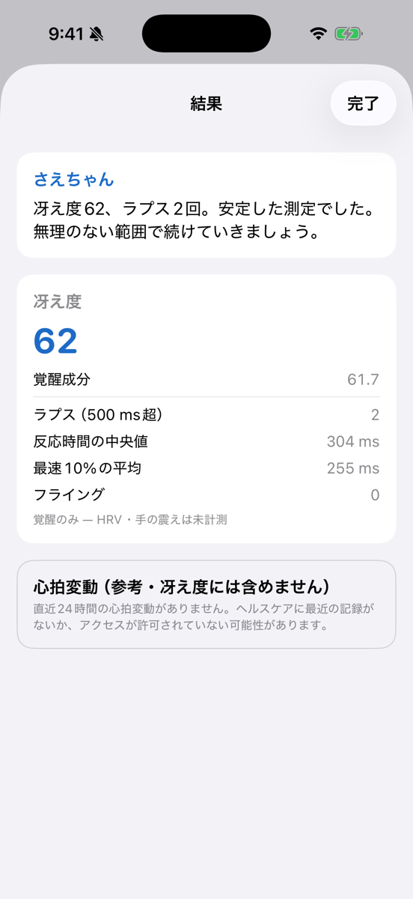 | 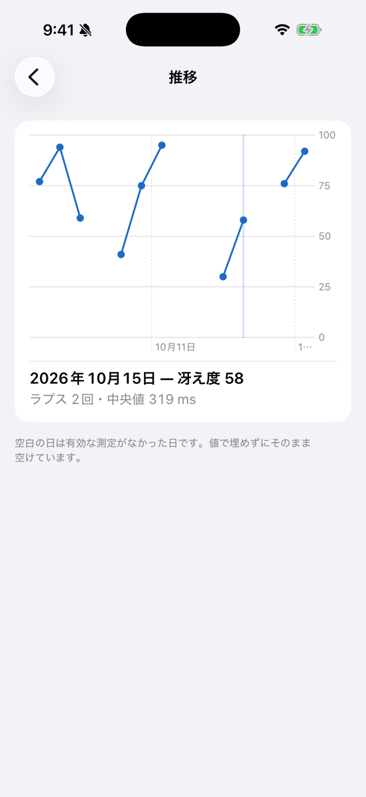 |

<sub>Captured on the iOS 26.4 simulator (iPhone 17 Pro) from a DEBUG build: home, result and trend use the in-memory demo data (`-homeDemo`, `-resultDemo`, `-trendDemo`) — the scores shown are computed by the real scorer from synthetic trials, not typed in — and the DEBUG-only "Timing lab (developer)" link is visible on home.</sub>

## Engineering highlights

This project is deliberately built around a few hard problems, each designed before a line of code:

- **⏱ Millisecond-accurate reaction timing.** Measuring true reaction time on iOS is harder than it looks — most apps get it wrong. Stimulus onset is taken from the `CADisplayLink` frame timestamp and the response from `UITouch.timestamp` (hardware event time), so display and dispatch latency never contaminate the measurement. Calibration offset and refresh rate are stored per session for reproducibility. → [`docs/timing-engine.md`](docs/timing-engine.md)
- **🔍 An explainable score, not a black box.** Every point of the 0–100 Sae-do score maps back to raw PVT metrics — "why 60?" always has an answer. → [`docs/score-algorithm.md`](docs/score-algorithm.md)
- **🔒 Privacy by default.** All health data is processed on-device. No servers, no tracking, no ad SDKs.
- **🌏 Internationalization as a design premise.** Trilingual (JA / EN / KO) from day one via String Catalog (`.xcstrings`) — no hardcoded strings, all three languages treated as equal. → [`docs/character-voice.md`](docs/character-voice.md)
- **🌡 Cold data, warm delivery.** A character layer (*Saechaan*) delivers hard numbers gently — warming the tone without ever distorting the data.

## Tech stack

Native Apple stack, zero third-party dependencies: **SwiftUI · SwiftData · Swift Charts · `CADisplayLink` + `UITouch.timestamp` + `CACurrentMediaTime` (precision timing) · HealthKit · CoreMotion · String Catalog · Swift Testing.** Minimum iOS 17.
→ [`docs/tech-stack.md`](docs/tech-stack.md)

## Design principles

Development is governed by a small **[project constitution](docs/CONSTITUTION.md)** — a top-level set of rules that any code, feature, or design must obey. Article 1 is non-negotiable: **measurement accuracy comes first**, proven by tests. When articles conflict, the lower-numbered one wins.

## Status

🚧 **In active development — all three signals are in: the PVT score, plus HRV and hand tremor as references.** Next: the demo video and device verification ([#5](https://github.com/2daKaizen-gun/sae/issues/5)). Implementation follows a 4-week MVP plan (see [`docs/CONCEPT.md`](docs/CONCEPT.md) §7).

**Working today**

- **Pure timing & scoring core** (`SaeTiming`, a local Swift package with no platform dependencies): reaction-time math, lapse / false-start / no-response classification, seeded ISI scheduler, session aggregation, validity gate, stimulus-schedule state machine, the clock contract, the Sae-do score, the day-by-day trend series, HRV sample selection and tremor analysis. Proven by **96 Swift Testing cases** that run without a simulator.
- **Measurement runtime**: stimulus onset taken from the `CADisplayLink` frame timestamp, response from `UITouch.timestamp` via a low-level touch path, no animation or async work inside the timing loop. A session is **12 trials** with a 10s response timeout.
- **Clock contract verified at runtime** — both timestamps are checked against a common clock, because reaction time is a direct subtraction and is meaningless if the two come from different bases.
- **Explainable Sae-do score (0–100)** — raw PVT metrics map onto sub-indices, combine into an alertness component, and produce the final score. The tests reproduce the worked example published in [`score-algorithm.md`](docs/score-algorithm.md) §6 to the same number, so the code and the document cannot silently drift. An **invalid session produces no score** rather than a made-up low one.
- **On-device persistence** (SwiftData): raw per-trial data with the refresh rate and calibration offset the session ran under, plus a daily score that stores the raw metrics behind it (not a frozen sentence), so past results can be recomputed and re-explained in any language.
- **Daily trend chart** (Swift Charts, last 14 days). A day without a valid score stays **blank** — the line is broken there rather than zero-filled or bridged, because either would draw a value that was never measured. Touching a day shows the raw metrics behind its score.
- **HRV from HealthKit, as a reference only** — read-only access, requested with its reason at the moment it is needed, kept on device. HealthKit's HRV is **SDNN** (not RMSSD, which the early design assumed), so it is labelled as SDNN and kept **out of the score** until an SDNN mapping can be sourced. A reading older than 24 hours is not shown as today's.
- **A small native design system** — tokens and shared components on system semantic colours, one brand colour with light / dark values (all text/background pairs at WCAG AA or better), Dynamic Type intact. Home shows today's score or says it was not measured. The score is **never colour-coded good/bad** — that would be an unsourced classification — and the stimulus rendering is outside the design system entirely.
- **A user-facing test flow** — Measure opens a short instruction screen (every number in it — rounds, false-start and minimum-response limits — read from the code), then a focused test screen, then the result. The test uses **the same engine and the same stimulus view** as the verification lab: one `StimulusPad`, the unchanged `PVTSessionRunner`. It starts only after the screen transition has finished, shows no reaction times until the end, keeps the screen awake, and stores nothing if abandoned. The instrument panel is now a DEBUG-only tool.
- **Saechaan's voice, kept apart from the engine** — the result opens with one line from the character, chosen in a separate `SaeVoice` target that only reads the engine's output. Every line starts with the engine's own numbers, then describes **the measurement, not the person** ("your responses were a little slow this time", never "you look tired"), then offers an optional, non-medical suggestion. The score bands that pick the tone (80/60/40/20) have no source, so they choose wording only and are never shown as labels. First-run onboarding states what the app is not: not a medical device, no diagnosis, data on the device only.
- **Hand tremor as a sourced reference** — a 10-second hold after the test; the accelerometer signal is detrended and the **5–12 Hz** band analysed, following the smartphone method of Santos et al. (2022, *Scientific Reports*, [DOI 10.1038/s41598-022-21310-4](https://doi.org/10.1038/s41598-022-21310-4)). The app reports band RMS (m/s²) and peak frequency, uses the *measured* sample rate, and says on screen that values compare only within one device — the same paper shows device mass changes the spectrum. Not in the score: there are no sourced anchors.
- **Trilingual from the first screen** (JA / EN / KO) via String Catalog — the result screen shows the score with its breakdown in all three.

**Deliberately not claimed yet**

- The **calibration offset is 0 — uncalibrated.** Deriving the real display/touch latency constant needs photodiode hardware ([`timing-engine.md`](docs/timing-engine.md) §8-3), so the app records "uncalibrated" rather than a made-up number.
- Verified **in the iOS simulator, not yet on a physical device** ([#5](https://github.com/2daKaizen-gun/sae/issues/5)).
- The MVP score is **PVT-only**: HRV and tremor stay out of the headline number until their anchors can be grounded.
- HRV and tremor in the score, character visuals and adaptive lines are later phases. Tremor recording on real hardware is unverified — the simulator has no motion sensor.

## Building and running

**Requirements:** Xcode 26 (developed with 26.4) and an iOS 17+ simulator or device. No package manager steps — the only packages are local.

```sh
git clone https://github.com/2daKaizen-gun/sae.git
cd sae
open Sae.xcodeproj          # then Run the "Sae" scheme on an iPhone simulator
```

**Tests** — the measurement core and the character layer are plain Swift packages, so they run without a simulator:

```sh
cd SaeTiming
swift test                  # Swift Testing, 96 cases
```

If `xcode-select` points at the Command Line Tools instead of Xcode, prefix the command with `DEVELOPER_DIR=/Applications/Xcode.app/Contents/Developer`.

### Project layout

| Path | What lives there |
|------|------------------|
| `SaeTiming/Sources/SaeTiming` | **Measurement core** — reaction-time math, trial classification, ISI scheduling, stimulus schedule, clock contract, session summary and validity, the Sae-do score, trend series, HRV sample selection, tremor analysis. No UIKit/SwiftUI. |
| `SaeTiming/Sources/SaeVoice` | **Character layer** — picks Saechaan's line. Reads `SaeTiming`; `SaeTiming` never imports it. |
| `Sae/` | The iOS app: runtime timing (`PVTSessionRunner`, `TouchCatcher`, `StimulusPad`), SwiftData models, HealthKit read, screens, `DesignSystem/`, String Catalogs, privacy manifest. |
| `docs/` | Design of record — constitution, timing engine, score algorithm, character voice, data model, handoff log. |
| `tools/` | `make-app-icon.swift` — regenerates the app icon. |

### DEBUG launch arguments

Set under *Edit Scheme → Run → Arguments*. They exist only in DEBUG builds; the demo ones use an in-memory store and never touch the on-device data.

| Argument | Opens |
|----------|-------|
| `-autolab` | The timing lab (instrument panel: refresh rate, clock-contract deltas, raw trials) |
| `-autointro` / `-autotest` | The test instructions / the test screen |
| `-homeDemo` | Home with demo history (today has a score) |
| `-resultDemo` | A result screen for a synthetic session — add `-demoLapses N` (0–12), `-demoInvalid` or `-demoNoHistory` (first-measurement line) |
| `-trendDemo` | The trend with 10 demo days — add `-trendSelect N` to preselect N days ago |
| `-resetOnboarding` | Shows the first-run onboarding again |

## Documentation

| Doc | What |
|-----|------|
| [`CONCEPT.md`](docs/CONCEPT.md) | What we're building, and why |
| [`CONSTITUTION.md`](docs/CONSTITUTION.md) | Top-level principles every decision obeys |
| [`data-model.md`](docs/data-model.md) | SwiftData schema (ERD) |
| [`tech-stack.md`](docs/tech-stack.md) | What we use, and why (by article) |
| [`timing-engine.md`](docs/timing-engine.md) | Millisecond timing & calibration design |
| [`score-algorithm.md`](docs/score-algorithm.md) | The explainable 0–100 Sae-do score |
| [`character-voice.md`](docs/character-voice.md) | Saechaan persona & trilingual copy |

## License

[MIT](LICENSE)
