# 冴え (Sae)

[](https://github.com/2daKaizen-gun/sae/actions/workflows/tests.yml)

An iOS app that measures how alert you are with a 90-second reaction-time test, and records it as a daily score from 0 to 100. No wearable needed.

90秒の反応時間テストで、その日の頭の冴えを 0–100 で記録する iOS アプリです。ウェアラブル端末は使いません。
名前は「頭が冴える」から取りました。日本語・英語・韓国語に対応しています。

## Why

"Sleep debt" (睡眠負債) is a common phrase in Japan, but it's hard to judge your own sleepiness.
The Psychomotor Vigilance Task (PVT) is a standard test in sleep research: reaction times get slower in a measurable way when you haven't slept enough.
Most reaction-time apps are games, and most sleep apps record you while you sleep. I wanted something that checks how alert you are during the day.

## What it measures

| Signal | Method | iOS | In the score? |
|--------|--------|-----|---------------|
| Alertness | PVT reaction-time test (12 trials) | `CADisplayLink`, `UITouch.timestamp` | Yes |
| HRV | SDNN from HealthKit | HealthKit | No, reference only |
| Hand tremor | 5–12 Hz band during a 10 s hold | CoreMotion | No, reference only |

## Screenshots

| Onboarding | Home | Instructions | Test | Result | Trend |
|---|---|---|---|---|---|
| 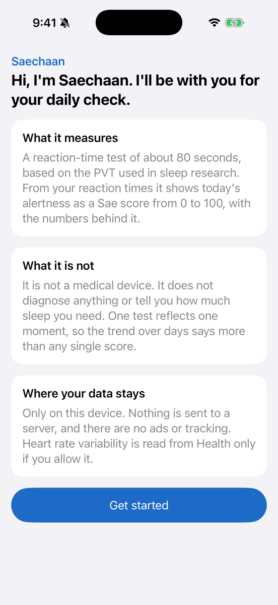 | 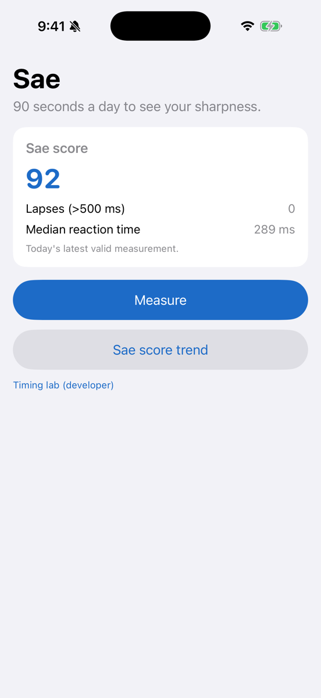 | 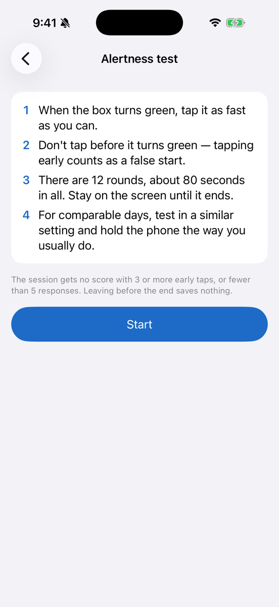 | 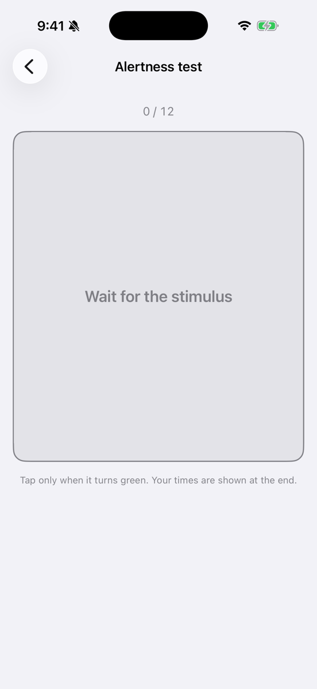 | 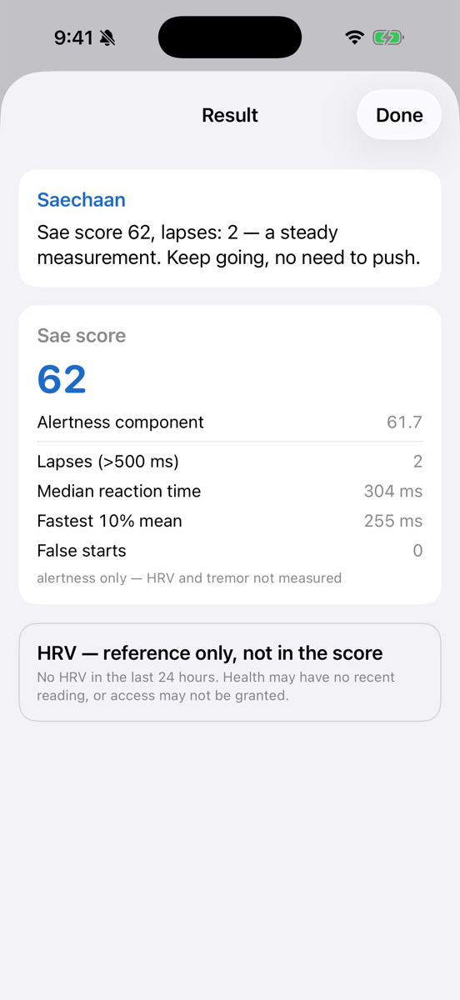 | 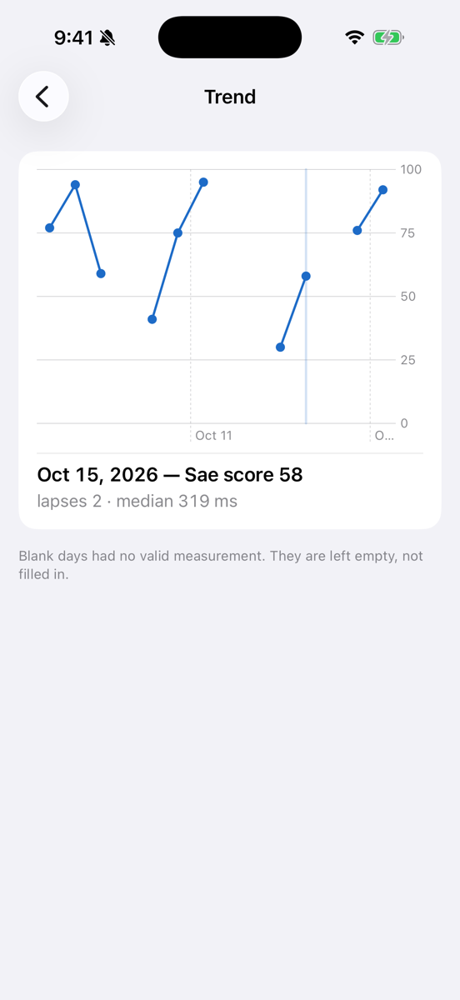 |
| 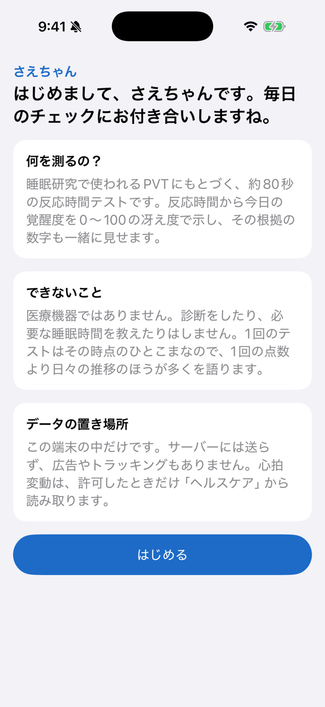 | 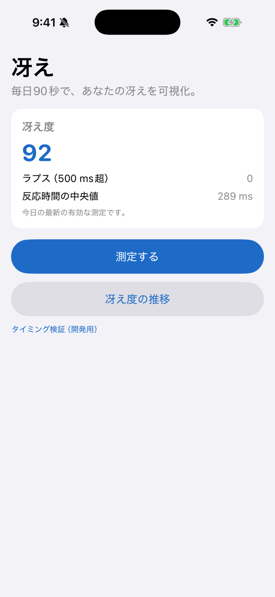 | 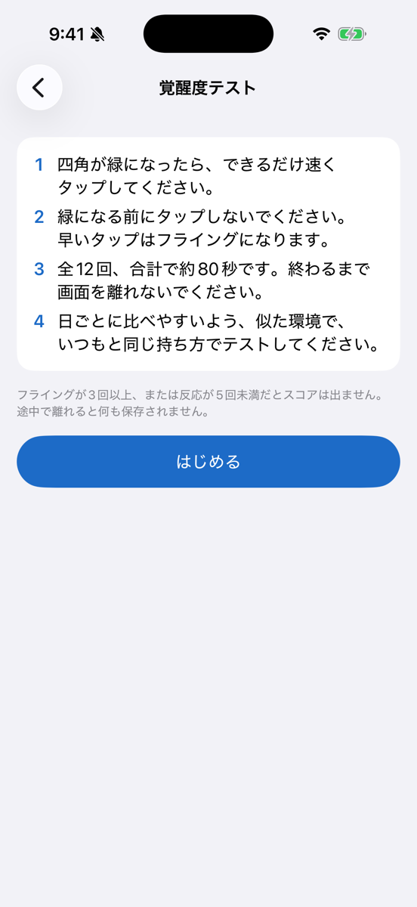 | 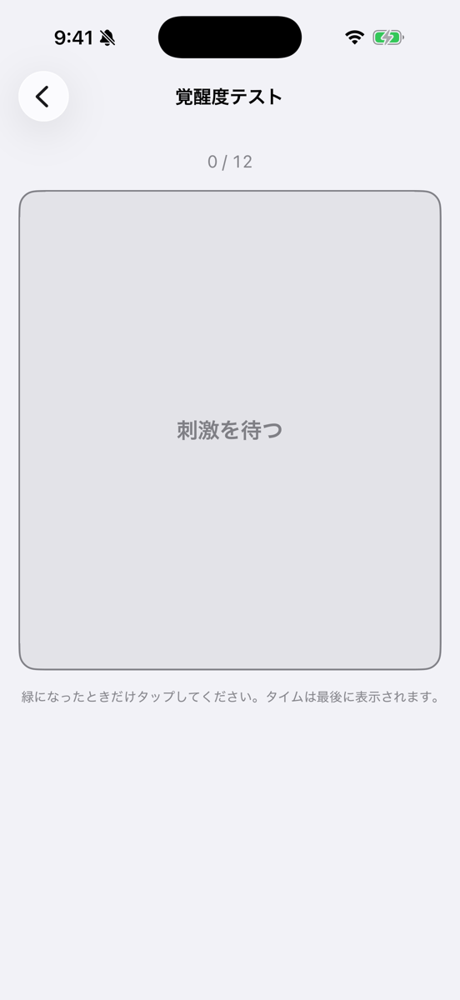 | 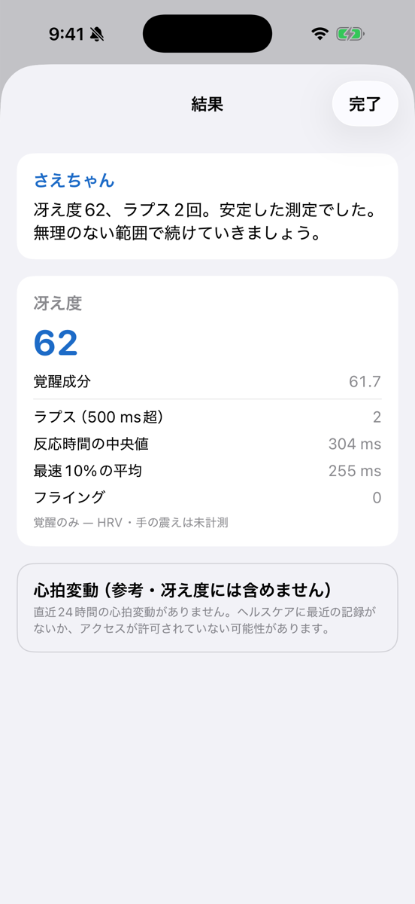 | 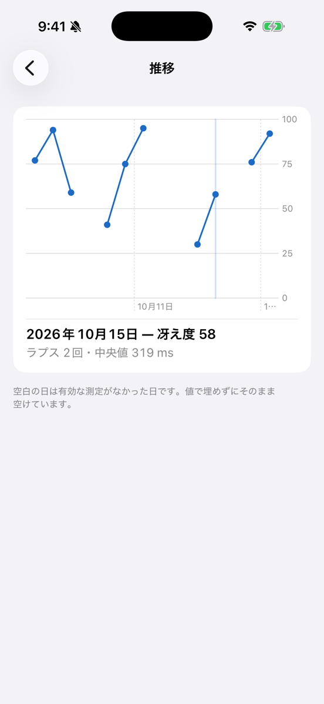 |

<sub>iOS 26.4 simulator (iPhone 17 Pro), DEBUG build with demo data. The scores are calculated by the real scorer from synthetic trials.</sub>

## How it works

- **Reaction timing**: the stimulus time comes from the `CADisplayLink` frame timestamp and the tap time from `UITouch.timestamp`, so drawing and event delays don't get added to the reaction time. Both are checked against the same clock at runtime. → [`timing-engine.md`](docs/timing-engine.md)
- **Score (0–100)**: calculated only from PVT results, and every part can be traced back to the raw numbers. A session that isn't valid gets no score instead of a low one. → [`score-algorithm.md`](docs/score-algorithm.md)
- **Data**: everything stays on the device (SwiftData). Raw trials are saved too, so past scores can be recalculated. There is a screen that deletes all of it.
- **Trend**: last 14 days with Swift Charts. Days without a valid score are left blank rather than drawn as zero. VoiceOver users get an audio graph.
- **Character**: Saechaan comments on the result, but only describes the measurement ("your responses were a little slow this time"), never the person. This part is a separate target that only reads the score.
- **Languages**: Japanese, English and Korean via String Catalog. A test fails if a string is missing in any language.
- **Accessibility**: every screen runs Apple's accessibility audit in CI, at default and largest text size.

The project rules (measurement accuracy first, etc.) are in [`CONSTITUTION.md`](docs/CONSTITUTION.md).

## Status

In development. The PVT score, HRV and tremor are implemented. Next is device testing and a demo video ([#5](https://github.com/2daKaizen-gun/sae/issues/5)).

Not done yet:

- Display/touch latency is not calibrated (the offset is 0). Measuring it needs a photodiode. ([`timing-engine.md`](docs/timing-engine.md) §8-3)
- Only tested on the simulator so far, not on a real iPhone. The simulator has no motion sensor, so tremor is untested on hardware.
- HRV and tremor are not in the score because I haven't found reliable reference values for them yet.

## Building and running

**Requirements:** Xcode 26 (developed with 26.4) and an iOS 17+ simulator or device. No package manager steps — the only packages are local.

```sh
git clone https://github.com/2daKaizen-gun/sae.git
cd sae
open Sae.xcodeproj          # then Run the "Sae" scheme on an iPhone simulator
```

**Tests** — two suites, both Swift Testing, both run by [CI](.github/workflows/tests.yml) on every pull request:

```sh
cd SaeTiming && swift test  # core + character layer, 96 cases, no simulator needed

xcodebuild test -project Sae.xcodeproj -scheme Sae \
  -destination 'platform=iOS Simulator,name=iPhone 17 Pro'   # app layer (20) + UI tests (16)
```

| Suite | Runs | What it proves |
|-------|------|----------------|
| `SaeTiming/Tests` (`SaeTimingTests`, `SaeVoiceTests`) | `swift test` · **CI on every PR and push to `main`** | Reaction-time math and classification, ISI scheduling, the stimulus schedule, the clock contract, session validity, every score anchor and the published worked example, the trend series, HRV selection, tremor analysis on synthetic signals, and Saechaan's line selection |
| `SaeTests` | `xcodebuild test` (iOS simulator) · **CI on every PR and push to `main`** (newest Xcode 26 on the runner) | What reaches the on-device store: a valid session stores its raw trials and the day's score, an invalid one stores no score, one score per day (the last valid session wins, a later invalid one erases nothing), when a measurement counts as the first, that deleting all records leaves nothing behind, the trend's audio-graph data, and that every string ships in all three languages with the same format specifiers |
| `SaeUITests` | same command (XCUITest) · **CI** | **A valid session end to end** — instructions → a real test (the UI test taps when the stimulus shows) → scored result → today's score on home; the first-run flow; deleting data (cancel keeps everything, confirm removes it); and Apple's accessibility audit on every user screen, at the default and the largest text size. One narrow exception, explained in code: the system-sized 'Done' bar button. |

If `xcode-select` points at the Command Line Tools instead of Xcode, prefix the command with `DEVELOPER_DIR=/Applications/Xcode.app/Contents/Developer`.

### Project layout

| Path | What lives there |
|------|------------------|
| `SaeTiming/Sources/SaeTiming` | **Measurement core** — reaction-time math, trial classification, ISI scheduling, stimulus schedule, clock contract, session summary and validity, the Sae-do score, trend series, HRV sample selection, tremor analysis. No UIKit/SwiftUI. |
| `SaeTiming/Sources/SaeVoice` | **Character layer** — picks Saechaan's line. Reads `SaeTiming`; `SaeTiming` never imports it. |
| `Sae/` | The iOS app: runtime timing (`PVTSessionRunner`, `TouchCatcher`, `StimulusPad`), SwiftData models, HealthKit read, screens, `DesignSystem/`, String Catalogs, privacy manifest. |
| `docs/` | Design docs: concept, timing engine, score algorithm, character voice, data model. |
| `tools/` | `make-app-icon.swift` — regenerates the app icon. |

### DEBUG launch arguments

Set under *Edit Scheme → Run → Arguments*. They exist only in DEBUG builds; the demo ones use an in-memory store and never touch the on-device data.

| Argument | Opens |
|----------|-------|
| `-autolab` | The timing lab (instrument panel: refresh rate, clock-contract deltas, raw trials) |
| `-autointro` / `-autotest` | The test instructions / the test screen |
| `-homeDemo` | Home with demo history (today has a score) |
| `-resultDemo` | A result screen for a synthetic session — add `-demoLapses N` (0–12), `-demoInvalid` or `-demoNoHistory` (first-measurement line) |
| `-trendDemo` | The trend with 10 demo days — add `-trendSelect N` to preselect N days ago |
| `-resetOnboarding` | Shows the first-run onboarding again |

## Documentation

| Doc | What |
|-----|------|
| [`CONCEPT.md`](docs/CONCEPT.md) | Concept and MVP plan |
| [`CONSTITUTION.md`](docs/CONSTITUTION.md) | Project rules |
| [`data-model.md`](docs/data-model.md) | SwiftData schema (ERD) |
| [`tech-stack.md`](docs/tech-stack.md) | Libraries and why |
| [`timing-engine.md`](docs/timing-engine.md) | Timing and calibration |
| [`score-algorithm.md`](docs/score-algorithm.md) | How the score is calculated |
| [`character-voice.md`](docs/character-voice.md) | Saechaan and the three-language copy |

## License

[MIT](LICENSE)
