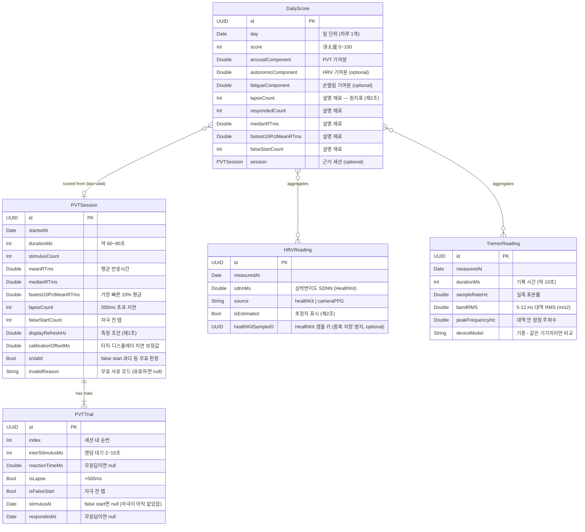

# 데이터 모델 (Data Model / ERD)

> 冴え(Sae)의 온디바이스 데이터 모델. **SwiftData** 스키마의 설계 근거다.
> 범위는 MVP 4주 계획(`CONCEPT.md` §7). 그 너머는 **Deferred**로 명시해 미리 만들지 않는다(헌법 제7조).
> 모든 데이터는 **온디바이스**에 남고 서버로 보내지 않는다(제3조).

- **최종 수정:** 2026-10-28 (삭제 정책)
- **저장소:** SwiftData (로컬)

---

## 설계 원칙 (이 모델이 헌법을 지키는 법)

- **제1조(정확도):** 반응시간은 **탭 단위 원자료(`PVTTrial`)로 저장**한다. 세션 요약값만 남기면 나중에 검증·재분석이 불가능하다. 디스플레이 주사율·보정 오프셋도 세션에 함께 기록해 측정 조건을 재현 가능하게 한다.
- **제2조(정직성):** 冴え度 점수는 **구성요소(각성/자율신경/피로)를 쪼개 저장**한다. "왜 62점인가"에 답할 수 있어야 한다. 추정치(카메라 PPG 등)는 `isEstimated` 플래그로 표시한다.
- **제3조(프라이버시):** 계정·서버 개념 없음. 단일 사용자 온디바이스. 개인 식별정보를 모델에 두지 않는다.

---

## ERD

---

## 엔티티 설명

### `PVTSession` — 한 번의 PVT 측정 (제품의 심장)
90초 측정 1회. 세션 요약 지표(평균 RT, lapse, fastest 10%, false start)를 담되, **원자료는 `PVTTrial`에** 둔다. `displayRefreshHz`·`calibrationOffsetMs`는 제1조의 "측정하고 보정한다"를 데이터로 증명하는 필드다. false start가 과하면 `isValid=false`로 세션을 무효 처리.

`invalidReason`은 무효 판정의 **근거**를 안정된 코드(`tooManyFalseStarts` / `tooFewValidTrials`)로 남긴다. "왜 무효인가"에 답하지 못하면 판정이 블랙박스가 된다(제2조 2항). 화면 문장은 코드가 아니라 String Catalog가 만든다(제5조 1항).

### `PVTTrial` — 한 번의 자극-반응
한 세션은 여러 trial을 가진다(`||--|{`). 각 trial은 랜덤 대기(`interStimulusMs`, 2~10초) 후 자극→탭까지의 반응시간을 밀리초로 기록. 무응답(타임아웃)이면 `reactionTimeMs`는 null이고 `isLapse=false`·`isFalseStart=false`다 — **무응답은 lapse와 따로 센다.** lapse는 "느리지만 응답한" trial(RT > 500ms)이라 RT 통계와 lapse율(분모 = 응답 수)에 들어가고, 무응답은 RT가 없어 어느 쪽에도 넣지 않는다(`TrialOutcome`, score-algorithm §1-1). **이 원자료가 있어야 정확도를 사후 검증**할 수 있다(제1조 3항, 제2조 1항).

`stimulusAt`은 **null일 수 있다**: false start는 자극이 켜지기 전에 누른 것이라 기록할 온셋이 없다. 예정돼 있던 목표 시각을 마치 표시된 것처럼 적으면 없는 측정을 지어내는 셈이 된다(제2조 1항). 벽시계 값(`stimulusAt`·`respondedAt`)은 **사람이 읽기 위한 기록**이고, 반응시간은 단조 시계로 이미 계산돼 저장된다 — 저장된 두 Date를 빼서 RT를 재구성하지 않는다(timing-engine §2).

### `HRVReading` — 자율신경/회복 (2~3주차)
HealthKit(애플워치) 또는 스트레치의 카메라 PPG에서 온 HRV. **HealthKit이 주는 HRV는 SDNN**이라 필드도 `sdnnMs`다(2026-09-29 정정 — 처음엔 RMSSD로 적었으나 HealthKit에 RMSSD 타입은 없다). 카메라 PPG를 도입하면 그때 지표를 다시 정한다. `healthKitSampleID`는 HealthKit 샘플의 UUID로, 같은 샘플을 다시 읽어도 **한 번만 저장**하게 하는 키다(2026-09-29 추가). HRV는 **冴え度에 들어가지 않는 참고 지표**다(score-algorithm §2). `source`로 출처, `isEstimated`로 추정 여부를 명시한다(제2조 3항).

### `TremorReading` — 신체 피로 (참고 지표, 2026-10-19 구현)
CoreMotion 가속도 약 10초 기록에서 뽑은 생리적 손떨림. 처음 설계의 `amplitude`·`axis` 대신 **실제 분석이 내는 값**을 저장한다: 5–12 Hz 대역 RMS(m/s², 세 축 합산)와 정점 주파수, 그리고 해석에 필요한 조건(실측 표본률·기록 시간). 방법과 출처는 `score-algorithm.md` §3-1(Santos et al. 2022).

**`deviceModel`을 함께 남긴다** — 같은 논문이 기기 질량이 손떨림 스펙트럼을 바꾼다고 보고하므로, 다른 기기에서 잰 값과 섞어 비교하면 안 된다(제2조). 기종 식별자는 기기 밖으로 나가지 않는다(제3조). 冴え度에는 들어가지 않는다(score-algorithm §3-2).

### `DailyScore` — 冴え度 (2주차~)
하루 1개. 세 신호를 융합한 0~100 점수. **구성요소를 분리 저장**해 설명 가능성을 보장하고, さえちゃん 대사는 이 값을 왜곡 없이 전달한다(제4조). HRV·손떨림이 없는 날은 각성(PVT) 성분만으로도 산출 가능하도록 두 성분은 optional이며, **MVP에서는 항상 nil**이다(Phase 2 확정 ①).

**`explanation` 문자열 대신 원지표를 저장한다 (2026-09-23 변경).** 설명을 문장으로 저장하면 **저장 시점의 언어가 박제**되어, 사용자가 언어를 바꾸거나 카피를 고치면 과거 기록만 옛 문장으로 남는다(제5조 2항). 그래서 문장 대신 **문장을 만들 재료**(`lapseCount`·`respondedCount`·`medianRTms`·`fastest10PctMeanRTms`·`falseStartCount`)를 저장하고, 문장은 표시 계층이 String Catalog로 만든다. 저장물이 요약문이 아니라 **검증 가능한 숫자**가 되므로 설명 가능성(제2조 2항)은 오히려 강해진다.

**무효 세션은 `DailyScore`를 만들지 않는다.** 억지 점수 대신 그날을 빈칸으로 둔다(score-algorithm §1-3). 하루에 여러 번 측정하면 **그날의 마지막 유효 측정**으로 갱신한다 — 최고 기록만 남기면 좋은 날만 모은 기록이 되어 추이가 왜곡된다. 이 규칙은 실사용 후 재검토할 열린 결정이다.

---

## 삭제 정책 (2026-10-28, 이슈 #26 — 제3조)

- 사용자는 홈의 **"이 기기의 데이터"** 화면에서 앱이 저장한 기록의 수(세션·하루 점수·HRV·손떨림)를 보고, 확인을 거쳐 **전부 지울 수 있다.**
- 지우는 대상: `PVTSession`(+ cascade로 `PVTTrial`), `DailyScore`, `HRVReading`, `TremorReading` — **앱이 만든 사본 전부.** 구현은 `MeasurementData.deleteAll`(모델별로 지워 관계 규칙을 따르고, 남은 trial을 한 번 더 정리). 저장에 실패하면 되돌린다(rollback).
- 지우지 않는 것: **건강 앱(HealthKit)의 데이터** — 앱은 읽기만 했고 쓴 적이 없다. 화면과 확인 창에서 이 사실을 말한다.
- 설정 플래그(온보딩 완료·HRV 요청 여부)는 측정 기록이 아니라 남긴다.
- 검증: 앱 테스트(지운 뒤 모든 수 0, 다시 기록 정상), UI 테스트(취소 시 유지, 확인 시 0).

## 관계 요약

- `PVTSession 1 : N PVTTrial` — 소유 관계(cascade delete). 세션을 지우면 trial도 지운다.
- `DailyScore → PVTSession` (to-one, optional) — **그날 점수를 만든 마지막 유효 세션**을 가리킨다. 원자료까지 거슬러 올라가 사후 검증하기 위해서다(제1조 3항). 같은 날의 `DailyScore`는 `day`(자정 기준) **날짜 조회**로 찾아 갱신한다(2026-09-23 구현으로 확정).
- `DailyScore ↔ {HRVReading, TremorReading}` — MVP 점수에 넣지 않으므로 아직 관계 없음. 3주차에 성분으로 합류할 때 정한다.

---

## Deferred (지금 만들지 않는다 — 제7조)

- **`UserProfile` / 개인 baseline** — 冴え度를 "자신의 평소 대비"로 정규화하려면 개인 기준선이 필요하지만, MVP는 절대 지표부터. 개인화 정규화는 필요해지는 시점(3주차 이후)에 도입 검토.
- **다중 사용자 / 계정** — 온디바이스 단일 사용자 전제(제3조). 만들지 않는다.
- **원격 동기화 / 백업** — 서버 전송은 제3조를 먼저 고쳐야 생긴다.

---

## 열린 결정 (스키마 확정 전 정할 것)

- ~~`DailyScore`의 집계를 날짜 쿼리로 할지 명시적 관계로 할지~~ → **둘 다**: 같은 날 조회는 `day` 날짜 쿼리, 근거 세션은 to-one 관계 `session`(2026-09-23 구현).
- 冴え度 산출 **가중치·공식** — `docs/score-algorithm.md`에 정의(제2조 2항, 설명 가능성).
- SwiftData 마이그레이션 전략 — 스키마 변경이 잦을 초기엔 가벼운 버전만.
